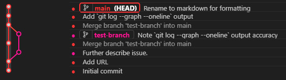
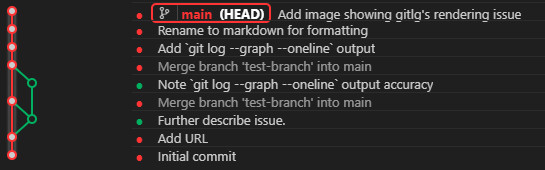

This is a minimum example repo for demonstrating a visual bug in gitlg.

This bug happens when one ongoing branch is merged into another multiple times.

**This bug only appears to occur when the merged-from branch is still a named branch**  
*ie. if you only pull main from this repo, then remove the remote, you WILL see the expected merge lines.*

Viewing `git log --graph --oneline` from main will correctly display merges:

```
*   0a4fca2 (HEAD -> main) Merge branch 'test-branch' into main
|\
| * 1cc617f (test-branch) Note `git log --graph --oneline` output accuracy
* | d5655af Merge branch 'test-branch' into main
|\|
| * 17f33bc Further describe issue.
|/
* ae5585c Add URL
* 6f029be Initial commit
```

However, with `test-branch` defined, gitlg does not render the merge line from `17f33bc` into `d5655af`:



Deleting `test-branch` results in the merge rendering as expected:



GitLG: <https://github.com/phil294/GitLG/>
